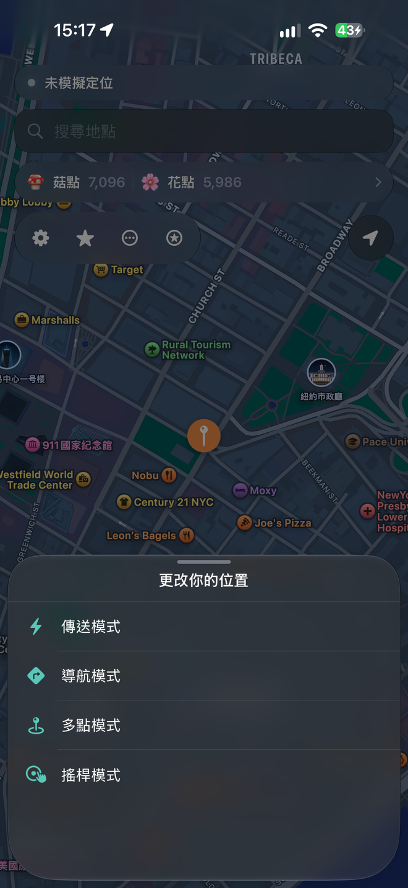
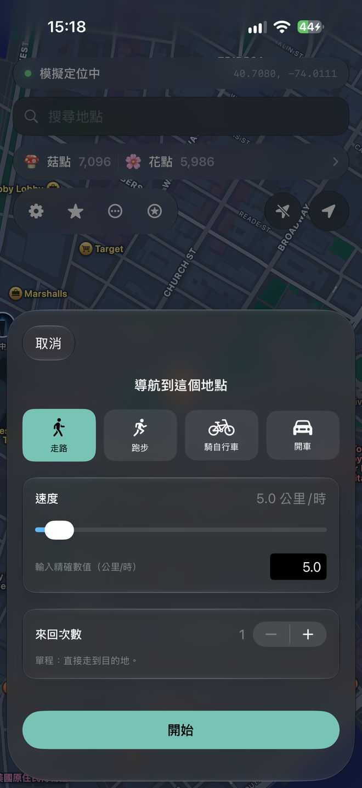
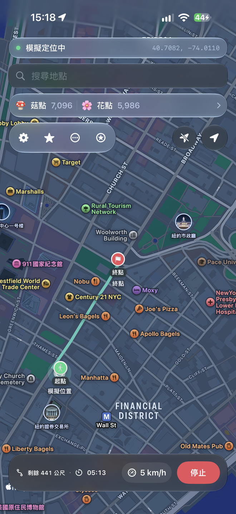
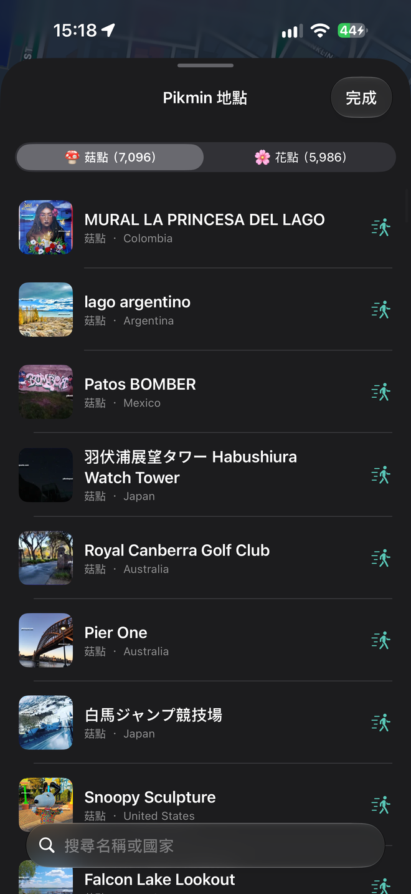

# Locus

> 本頁為**繁體中文版**。英文原版請見 [ChrisMack32/Locus](https://github.com/ChrisMack32/Locus)。

免費且開源的 iPhone 定位瞬移工具。點地圖、搜尋地點，或沿路線移動——Locus 透過 Apple 的**開發者定位服務**把座標注入 `locationd`，所以地圖和其他 App 看到的是真正被模擬的 GPS（不是靠 Wi‑Fi 定位猜測，之後會被戶外 GPS 蓋掉的那種）。

<p align="center">
  
  
  
  
</p>

## 功能

- 點地圖放圖釘，立即選擇這次要怎麼移動：**傳送**（瞬移）、**導航**（從目前位置自動規劃路線）、**多點模式**（依序走訪你放的每個點）、**搖桿**（即時手動操控）
- 搜尋地名、完整郵寄地址或經緯度；支援中英文混合地址，例如 `1 Titans Wy, Nashville, TN 37213美國`，選到地點後會直接詢問移動方式
- 依真實道路與人行步道規劃路線（MapKit），支援走路／跑步／騎車／開車
- 除了預設的速度檔位，也能自訂精確速度，而且路線或搖桿移動中可以即時調整，不用先停下來重設
- 移動時顯示剩餘距離與預估到達倒數；抵達目的地後自動結束路線，不必再手動按停止
- 匯入／匯出 GPX 路線
- 背景保持連線＋即時狀態列＋斷線通知
- 收藏與最近地點，收藏可以分類整理
- 透過首頁的 **Pikmin 地點**按鈕瀏覽菇點、花點、明信片地點與金盆，清單中可搜尋名稱或國家，選取後再決定移動方式
- 菇點、花點與明信片的名稱、經緯度及縮圖資料隨 App 保存在本機，不會在每次瀏覽時重新爬取網頁；金盆會即時更新，離線時使用內建快照
- 來自不同資料來源但座標相同的地點會自動合併，避免清單出現重複項目
- 首次使用設定精靈
- 完全在裝置端運作——沒有任何分析或上傳行為

## 安裝

完整步驟請看 [SETUP.md](SETUP.md)。你可以到 [Releases](https://github.com/OwOb0708/Locus/releases) 抓已經編譯好的 IPA，或是照下面的方式自己從原始碼編譯。

Bundle ID：`com.chrismack.locus`

下載後請確認檔名保留為 `Locus.ipa`，再交給 SideStore、AltStore 或其他側載工具安裝。若通訊軟體把檔案改成沒有 `.ipa` 副檔名的 UUID 名稱，請先在「檔案」App 中重新命名；SideStore 顯示「File does not exist at 'Locus.ipa'」通常代表收到的檔案路徑或副檔名不正確，並非 App bundle 缺失。

### LiveContainer

在 LiveContainer 裡，檔案選擇器常常會失效。可以用下面任一種方式解決：

1. 長按 **Locus** → **設定** → 開啟 **修正檔案選擇器**，再試一次匯入。
2. 把配對檔案分享**到 LiveContainer → Locus**。
3. 複製 RPPairing 的 plist 內容 → 在 Locus 裡用**從剪貼簿貼上 RPPairing**（設定精靈或「設定」頁都有）。

## 運作原理

Locus 使用 MIT 授權的 [idevice](https://github.com/jkcoxson/idevice) FFI，透過裝置端的開發者穿隧通道跟 Apple 的 DVT 定位模擬服務溝通（跟 Xcode 用的是同一類機制）。

**iOS 27：**到「設定」→ **在這支 iPhone 上配對**，會廣播 `_remotepairing-pairable-host._tcp`。到「設定」›「隱私權與安全性」›「開發者模式」›「與主機配對」確認那組 6 位數代碼即可——不需要電腦。

**iOS 18–26：**用 [idevice_pair](https://github.com/jkcoxson/idevice_pair/releases) 匯入一次 **RPPairing** 檔案。

另外要安裝 **[LocalDevVPN](https://apps.apple.com/us/app/localdevvpn/id6755608044)**（本機迴圈穿隧通道，預設 `10.7.0.1`），再把 Locus 側載上去。

第一次瞬移建議先在 Wi‑Fi 下進行，之後連線可以在行動網路下繼續運作。

### Pokémon GO 及類似遊戲

Locus 跟 Xcode 開發工具用的是同一種定位模擬方式：告訴 iOS「你在這裡」，其他 App 會從系統讀到這個結果。單純相信 GPS 的 App（Apple 地圖等）都會照著跑。

**Pokémon GO 是例外。** 它有自己一套定位檢查機制，通常會拒絕開發者／模擬的 GPS（例如出現「Failed to detect location」）。這是這種方法本來就會遇到的狀況，不是 Locus 的問題，這個 App 也沒有支援的解法。

像 **iPogo**（以及 SpooferPro 等類似的改版客戶端）運作方式不同：它們是**修改過的 Pokémon GO App 本身**，不是系統層級的定位模擬。功能是做在*那個被改過的遊戲用戶端裡面*，而不是像 Locus 這樣透過 iOS 系統把座標餵給所有 App。Locus 不會修補或取代 Pokémon GO，它只改變系統回報的內容。所以那類工具在 Pokémon GO 裡「看起來有效」，而 Locus 正確地驅動了地圖，卻還是會被 Pokémon GO 自己的檢查擋下來。

Locus 是系統層級的定位瞬移工具，不是 Pokémon GO 用戶端，也不是反偵測外掛。

## 編譯

從原始碼編譯需要一組 Apple Developer 帳號（免費或付費皆可）來做程式碼簽署。官方發布的 IPA **不需要**——直接側載就好。

1. 如果還沒裝，先安裝 [XcodeGen](https://github.com/yonaskolb/XcodeGen)：`brew install xcodegen`
2. 在 `project.yml` 裡設定你的 **Team ID**（`DEVELOPMENT_TEAM`），或是在產生專案後到 Xcode → Signing & Capabilities 選你的 Team。
3. 產生並打開專案：

```bash
xcodegen generate
open Locus.xcodeproj
```

或是用命令列編譯（把下面的 Team ID 換成你自己的，到 [developer.apple.com/account](https://developer.apple.com/account) → Membership 查）：

```bash
xcodegen generate
xcodebuild -project Locus.xcodeproj -scheme Locus -configuration Release \
  -destination 'generic/platform=iOS' DEVELOPMENT_TEAM=YOUR_TEAM_ID build
```

目前 `Vendor/idevice/libidevice_ffi.a` 是 iPhone 實機版本，因此請選擇實機或 `generic/platform=iOS` 編譯；直接建置到 iOS Simulator 會因靜態函式庫架構不相容而連結失敗。

## 授權

MIT 授權。基於 [ChrisMack32/Locus](https://github.com/ChrisMack32/Locus)（同樣是 MIT 授權）修改。`Vendor/idevice` 內含 idevice FFI（同樣是 MIT 授權）。Locus 與 Mirage／Wapixel 沒有任何關係。
